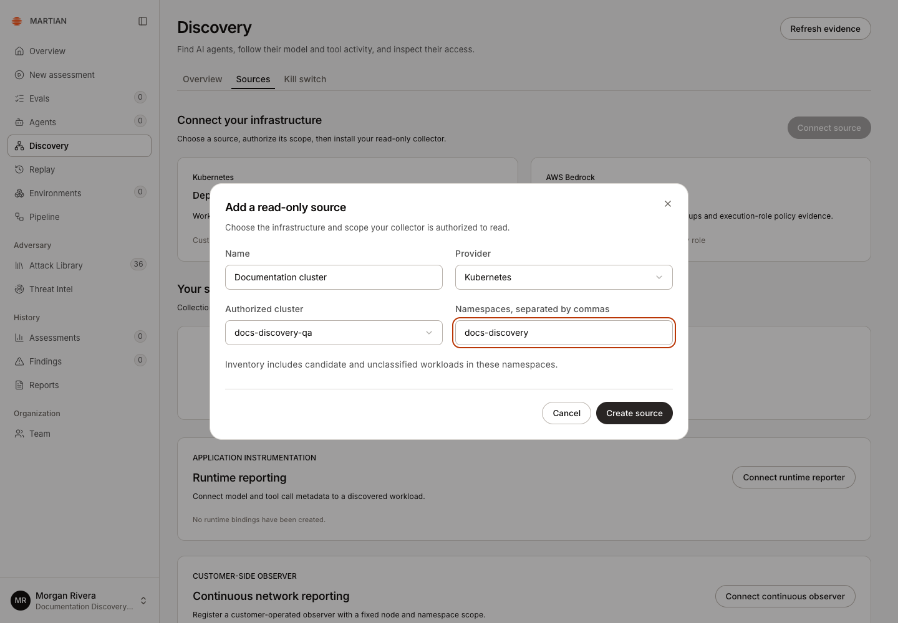
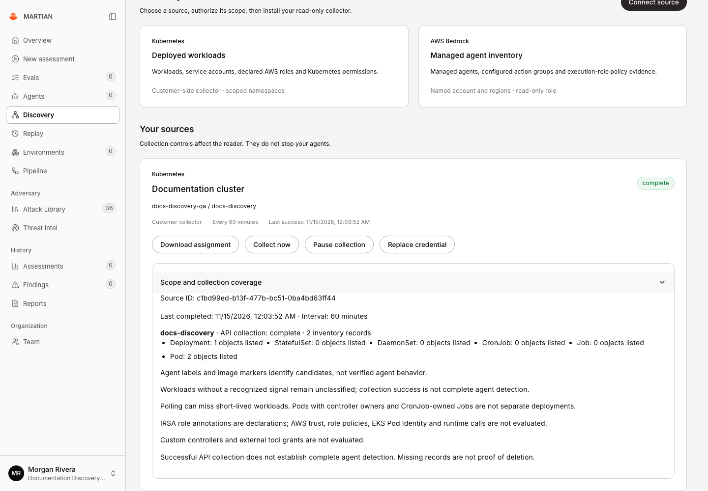
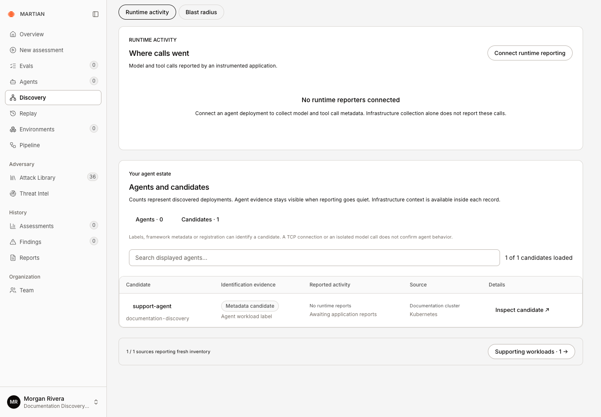
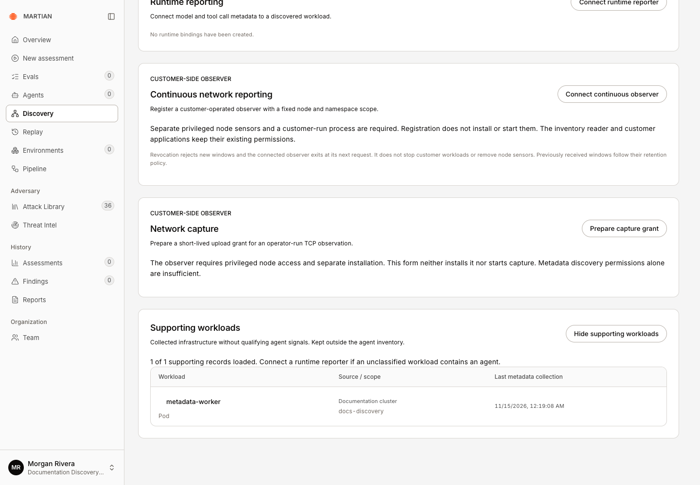
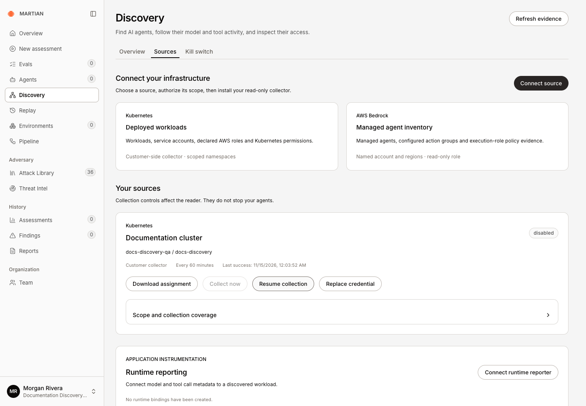
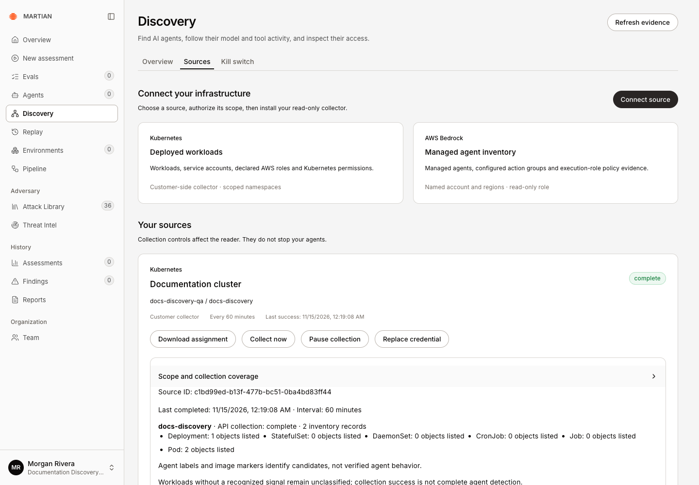

# Connect sources and inspect inventory

> Enroll an authorized read-only source, follow collection status and distinguish observed agents from candidates and supporting workloads.

Source: [Web version](https://docs.martiansecurity.ai/discovery/inventory/)

> **Page qualification:** Current beta console · owner, admin · Verified 2026-11-14 · Isolated Discovery compatibility QA; real customer Owner, authorized Kubernetes namespace, unchanged collector; Backend candidate PR112, not merged or deployed to beta. [Verification details](https://raw.githubusercontent.com/MartianSecurity/martian-security-docs/main/public/markdown/reference/verification.md).

Build an inventory from authorized infrastructure evidence and inspect what qualifies each record as an agent, candidate or supporting workload. Enrollment succeeds when the source is saved, its intended collector reports and retained inventory appears with a clear freshness boundary.

## Before you start

Any signed-in tenant user can inspect accessible inventory. **Owner** or **Admin** is required to create/manage sources and reporting bindings. Your operator must authorize the provider scope, such as a Kubernetes cluster alias or named AWS account/regions and read-only role. Customer-side collection requires the actual collector to be installed and running in that authorized environment.

Source collection, runtime reporting and assessment connections have separate credentials and purposes. Creating a source does not start a process or stop an agent.

Start with an approved scope

This walkthrough uses a customer-run Kubernetes collector in an authorized test namespace. Your operator supplies your cluster alias, namespace scope and a collector package compatible with your Backend deployment. The inventory reader needs workload and RBAC metadata access; it does not need permission to read Secrets, execute in containers or change workloads.

## Enroll a read-only source

1.  Open **Discovery → Sources** and choose **Connect source** to open **Add a read-only source**.
2.  Select the supported provider and enter its authorized scope. For Kubernetes, choose an authorized cluster and namespaces. For AWS Bedrock, enter the approved account, regions and **Read-only role ARN**. An empty authorized-cluster list needs operator setup first.

Select the operator-approved cluster and namespace before Create source. Enrollment alone does not collect inventory.

3.  Review the selected cluster and namespaces, then click **Create source**. A saved source is an enrollment; it has not collected anything yet.

4.  For a customer-side collector, save its once-shown credential privately and **Download scope assignment** or **Download assignment**. The assignment describes scope; the separate credential authenticates the collector. Close the credential panel before making screenshots or sharing the screen.

5.  Install/run the approved collector with that assignment and private credential in its authorized environment. Use the installation package and instructions supplied for your deployment; an enrollment alone is not collection. For hosted collection, the configured hosted reader performs the work.

6.  Inspect **Your sources**, collection mode, collection state, interval and **Last success**. Use **Collect now** only for an enabled, authorized source. It queues the next collector poll; it does not itself collect inventory.

7.  Wait for a distinct collection run and a newer completion / **Last success** time. Inspect its complete, partial or failed coverage and the retained workload identities, then refresh. A queued response or an unchanged old inventory snapshot is not evidence of a new successful collection. If the collector cannot run, fix that prerequisite instead of repeatedly selecting Collect now.

Scope and collection coverage records one Deployment and two listed Pods. The resulting two inventory records include a candidate and supporting infrastructure.

Expand **Scope and collection coverage** to read the namespace and per-kind API results. In this example, the reader listed one Deployment and two Pods, then retained two inventory records: one candidate Deployment and one standalone supporting Pod. The Deployment’s controller-owned Pod is not counted as another deployment. These counts do not establish complete agent detection.

## Review inventory and evidence

1.  Open **Discovery → Overview** and choose **Dashboard source** or all sources.
2.  Inspect the inventory’s agent/candidate view and its evidence labels. **Runtime-observed** requires qualifying trace-correlated model/tool reports; **Provider-listed** identifies a managed agent listed by its provider. Metadata or registration alone remains a candidate.
3.  Use **Search displayed agents** for the loaded page. Check loaded/total counts and pagination; a page search is not a proof that the entire organization has no matching record.
4.  Choose **Candidates** when inspecting metadata-only records. Select **Inspect candidate ↗** to open **Hosting & identity** or **Configured access**. Check the source, namespace, collected identity and collection time. The console’s hosting view does not show a live running-state check; confirm current workload health in your infrastructure.

The labeled Deployment is a candidate, not an established AI agent. Inspect candidate opens its retained infrastructure evidence.

5.  Choose **Supporting workloads** to open **Sources**, then **Review supporting workloads** if the section is collapsed. In this example, `metadata-worker` is retained as supporting infrastructure because its metadata has no recognized agent signal.

The standalone Pod remains supporting infrastructure outside the agent and candidate counts. A successful collection does not imply that every workload is an agent.

6.  Continue to **Runtime activity** or **Blast radius** to inspect a selected deployment’s evidence. Infrastructure inventory by itself does not report actual model/tool calls or independently establish effective permission.

## Pause, resume and verify freshness

1.  Under **Sources → Your sources**, select **Pause collection**. Expect a **disabled** source, disabled **Collect now**, and a retained **Last success** time. A customer collector that requests a new lease while paused is rejected; its old collection remains available.

Pausing rejects a new collector lease and preserves earlier inventory. It does not stop the workload.

2.  Select **Resume collection**, then **Collect now** to queue the next poll. Run or wait for the actual authorized collector. Resuming or queueing alone does not establish a new collection.
3.  Confirm a distinct completed collection and a newer **Last success**, then refresh the page. Check that the expected candidate and supporting record remain visible.

Resume collection and Collect now were followed by an actual collector run. A newer Last success and retained inventory confirm that distinct completion.

Collection controls affect the reader. They do not stop the customer’s application, contain network traffic or cancel an assessment.

## Recover from setup or collection failures

No authorized clusters

Ask your operator to authorize the cluster alias and namespace scope. The disabled **Create source** button cannot be fixed by entering an arbitrary cluster name. Confirm the collector and Backend contracts are compatible before running collection.

This beta QA Owner can inspect the source form, but no cluster alias is authorized. Stop for operator setup; no source or collector credential was created.

-   **Replace credential** rotates a customer collector credential. Install the replacement in the intended collector; saving it does not restart that process automatically.
-   A stale or failed source needs its actual reader, authorization and connectivity checked. Do not treat a retained old snapshot as fresh inventory.
-   Revoking a runtime reporter is a different operation from pausing inventory collection. Separate historical identity evidence from recent activity.
-   Network observations do not promote a workload into an agent or prove that every connection succeeded.

Network capture and continuous observers have a separate [setup and lifecycle](https://raw.githubusercontent.com/MartianSecurity/martian-security-docs/main/public/markdown/discovery/network-observation.md); inventory-reader credentials do not install node sensors. Continue with [runtime reporting and blast radius](https://raw.githubusercontent.com/MartianSecurity/martian-security-docs/main/public/markdown/discovery/runtime-and-blast-radius.md) and [call gates](https://raw.githubusercontent.com/MartianSecurity/martian-security-docs/main/public/markdown/discovery/call-gates.md). Review [permissions](https://raw.githubusercontent.com/MartianSecurity/martian-security-docs/main/public/markdown/reference/permissions.md) and [limits](https://raw.githubusercontent.com/MartianSecurity/martian-security-docs/main/public/markdown/reference/limits.md) before interpreting coverage.
