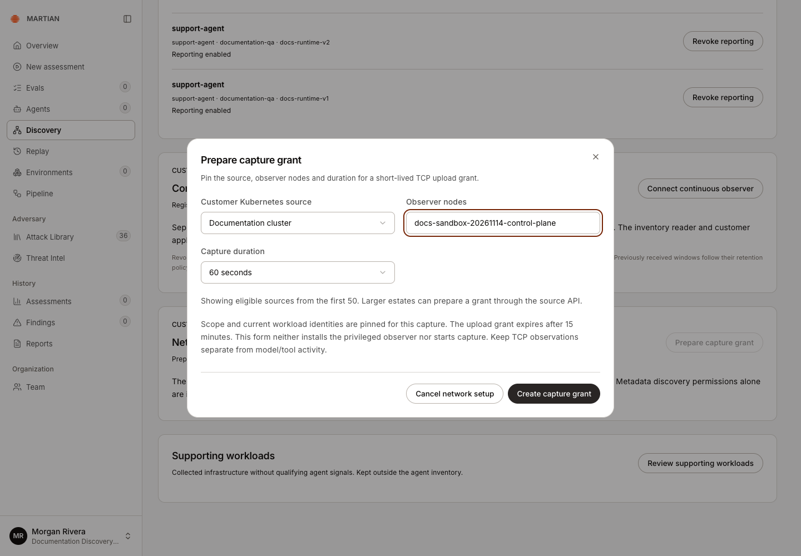
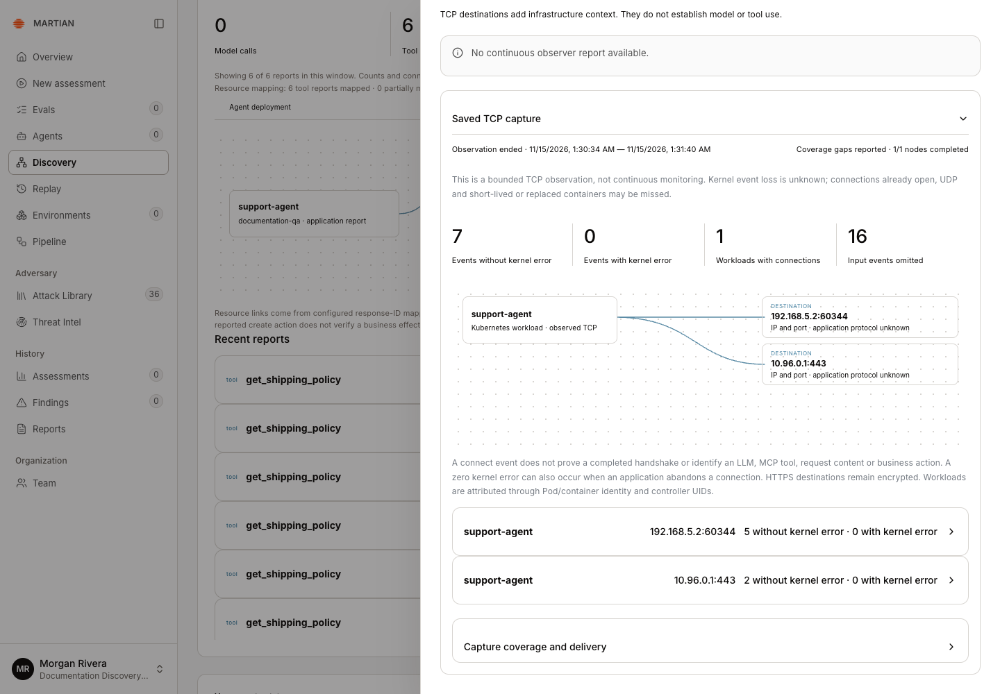
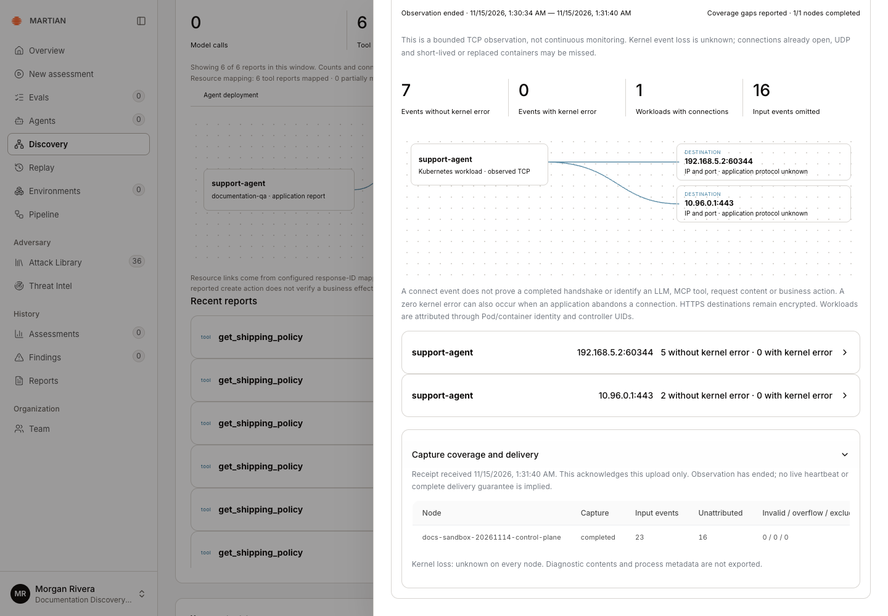
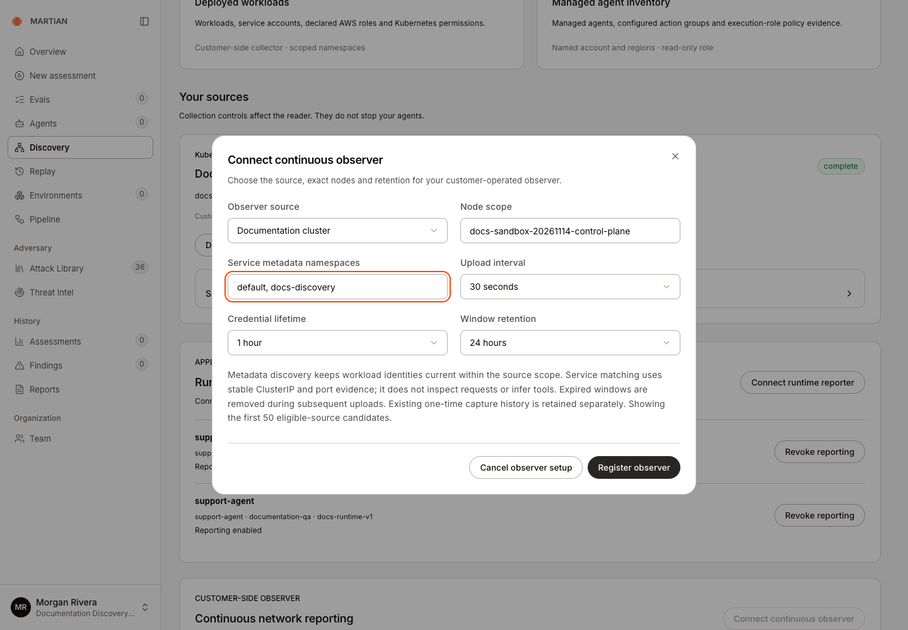
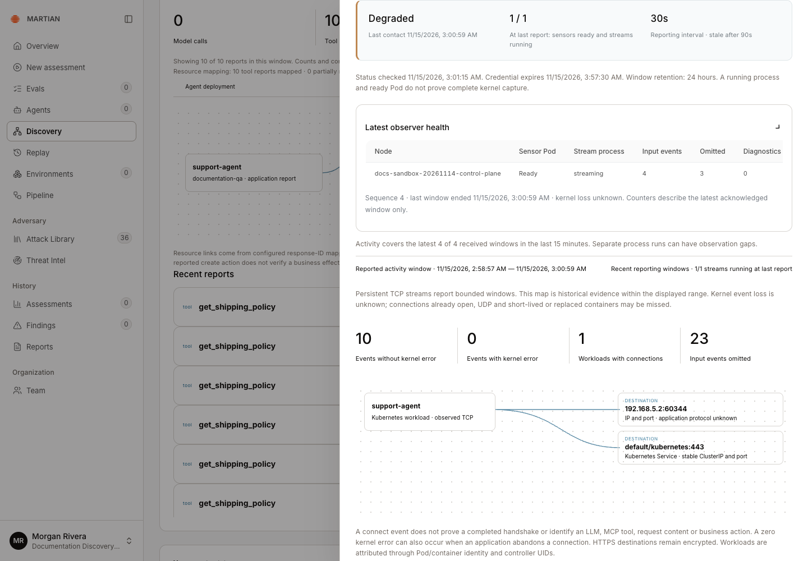
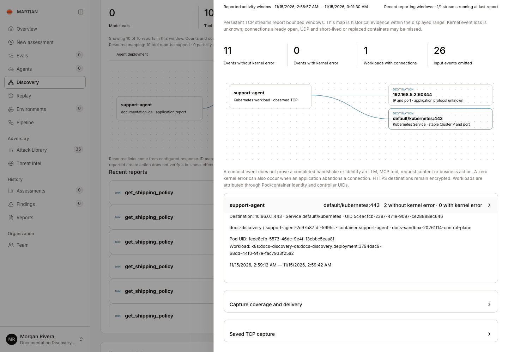
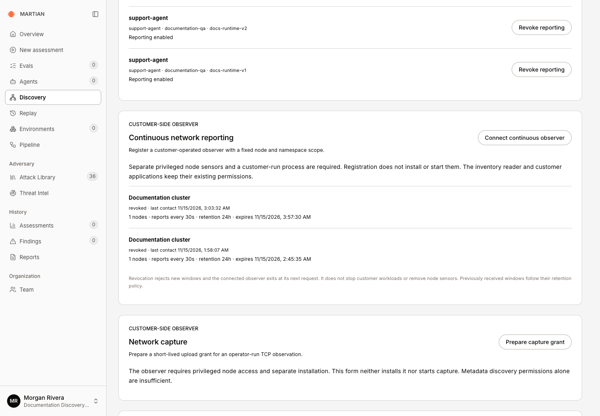
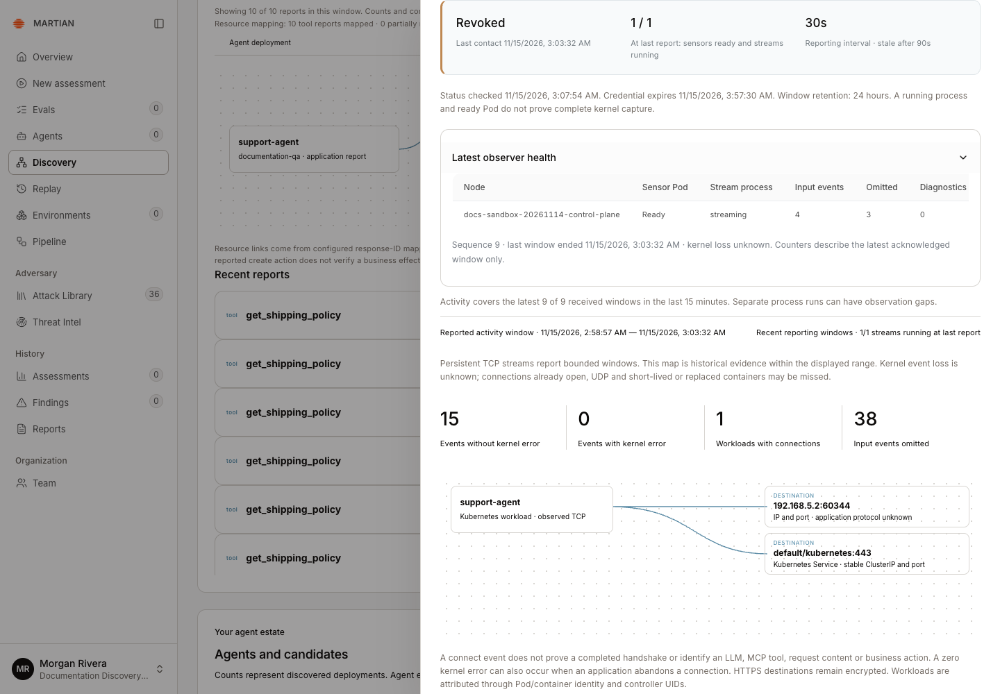
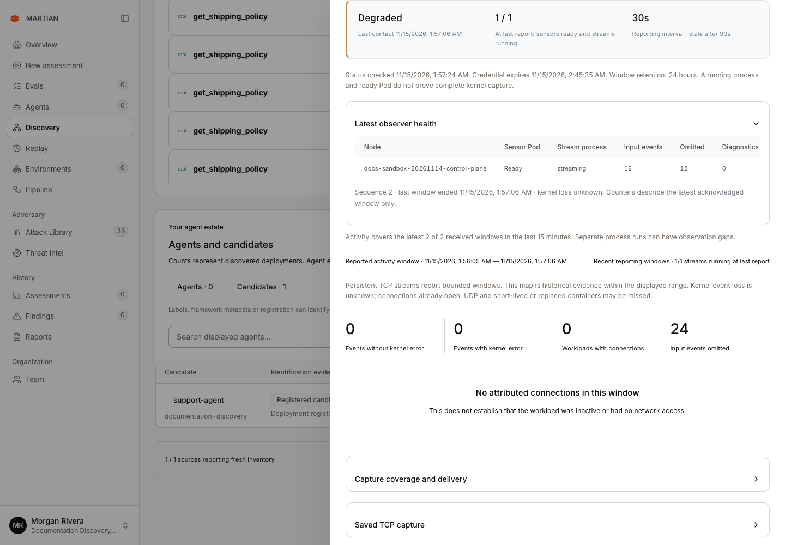

# Set up network observation

> Prepare a short-lived capture grant or enroll a continuous customer observer, then inspect reporting health and evidence limits.

Source: [Web version](https://docs.martiansecurity.ai/discovery/network-observation/)

> **Page qualification:** Current beta console · owner/admin manages; authorized roles read · Verified 2026-11-14 · Isolated Discovery compatibility QA; actual customer Owner with platform_admin false; real authorized Kubernetes provider; unchanged collector and SDK; Backend candidate PR112, unmerged and not deployed to beta. [Verification details](https://raw.githubusercontent.com/MartianSecurity/martian-security-docs/main/public/markdown/reference/verification.md).

Observe scoped TCP activity from customer-operated Kubernetes sensors. A one-time capture and a continuous observer have separate grants and lifecycles. Neither grants model/tool reporting, blocks calls or activates network isolation.

## Before you start

An **owner/admin** manages grants and observers; authorized customer users inspect retained evidence. First obtain an enabled **customer Kubernetes source**, compatible collected workload identities, exact authorized nodes and a customer cluster operator who can install the approved privileged sensors and observer process.

Inventory read permission does not grant privileged node access. The console does not install or start sensors. Obtain the compatible observer package and installation procedure from your operator; this customer guide covers its console enrollment and evidence checks. Sensors have a separate host-access trust boundary. Namespace event filtering is not tenant isolation.

## 1\. Prepare a one-time capture

1.  Open **Discovery → Sources → Network capture**, then **Prepare capture grant**.
2.  Choose **Customer Kubernetes source** and enter exact comma-separated **Observer nodes**.
3.  Select **Capture duration**: 30 seconds, 60 seconds, 2 minutes or 5 minutes.

Prepare the scoped upload grant before the authorized operator starts a separate sensor-backed capture. The form does not install sensors.

4.  Choose **Create capture grant**. This pins scope/current workload identities and prepares an upload grant; it does not start capture.
5.  Save the once-shown **Capture upload credential** privately and use **Download capture assignment**. The assignment excludes the secret. Keep this panel private. To revoke through this panel after the bounded check, leave it open until the operator confirms the upload; **Credential saved** clears both the panel and its revoke button.
6.  Have the authorized operator run the scoped observer with that assignment, credential and trusted Backend origin. The upload grant expires after 15 minutes; do not widen scope or change the endpoint to bypass an error.
7.  Ask the operator to confirm the retained upload receipt after the observer finishes. For this one-time check, choose **Revoke this upload grant** while the panel is open. This clears the panel and ends upload authority; the recorded receipt remains readable.
8.  Open **Discovery → Overview** and select the relevant agent or candidate. For a candidate, choose **Inspect candidate ↗**, then **Network evidence → Saved TCP capture**. The setup form does not open the receipt automatically. An authorized workspace user can also read it through `GET /v1/discovery/network-captures/{capture_id}`.

The saved partial receipt remains readable after upload-grant revocation. TCP connect metadata does not identify application requests or prove a completed handshake.

9.  Expand **Capture coverage and delivery**. Read the actual ended window, node command status, input events and omission/attribution diagnostics. An issued grant, a completed node command or an empty result does not establish complete capture or an idle workload.

Read the delivered receipt and omission counters before interpreting the map. A completed node command does not imply complete capture.

Read coverage before interpreting the map

The recorded example returned two destination groups and a **partial** receipt: 16 input events could not be attributed. Kernel loss remains unknown. **Events without kernel error** does not mean successful handshakes or verified application actions.

**Revoke this upload grant** is available while the once-shown grant panel is open. **Credential saved** clears that panel and its revoke button; retain the capture ID privately. For later revocation, an owner/admin uses the authorized `DELETE /v1/discovery/network-captures/{capture_id}` API or asks the workspace operator to do so. Revocation prevents further uploads. Stop the customer-side capture process through its operator procedure as well; it does not stop customer applications or remove sensors.

## 2\. Connect a continuous observer

1.  Under **Continuous network reporting**, choose **Connect continuous observer**.
2.  Select **Observer source**, enter the exact **Node scope** and **Service metadata namespaces**, then choose **Upload interval**, **Credential lifetime** and **Window retention**.

The source workload namespace and service-metadata namespaces are distinct scopes. Registering this grant neither starts the observer nor changes application permissions.

3.  Choose **Register observer**. Privately save **Observer upload credential**, use **Download observer assignment**, then select **Observer credential saved**. Only one unexpired, unrevoked observer grant is allowed per source; revoke an existing grant before replacing it.
4.  Have the operator install/configure the separately approved sensors and customer-run process using that exact assignment. Registration alone does not start them or change workload permissions.
5.  Open the relevant inventory record under **Discovery → Overview**, then **Network evidence**. Its continuous view follows the latest observer for that workload’s source. Return to **Sources → Continuous network reporting** to manage the registration.
6.  Read last contact, reporting/stale state, credential expiry and the expected reporting interval. Expand **Latest observer health** for each node’s sensor readiness, stream status, input events, omitted events and diagnostics.

Sequence four was fresh at capture time. The map contains the workload and two destinations while Degraded and the omission counters remain visible.

7.  Confirm a newly completed window and its sequence/time after the process reports. Refresh and verify retained evidence. A Ready Pod or running process does not establish complete kernel capture.
8.  Select a destination card, then expand its connection row. A matched Kubernetes Service shows its namespace/name, UID, ClusterIP and TCP port. An IP-and-port destination can remain **unresolved** even when other destinations have Service matches.

The two real policy reads produced a stable default/kubernetes:443 match. Its UID was independently checked against Kubernetes; this is destination metadata, not proof of a backend Pod or business effect.

Read the map and health together

The completed example delivered nine windows with two real destinations, including **default/kubernetes:443**. Its Service UID matched an independent Kubernetes read. Coverage still showed **Degraded**: 38 of 53 inputs were unattributed, leaving 15 attributed connect events. Service matching does not establish which backend Pod handled a request, a completed handshake or complete capture.

## 3\. Stop reporting and retain the right evidence

1.  Return to **Discovery → Sources → Continuous network reporting** and choose **Revoke observer reporting** for the intended registration.
2.  Refresh and confirm **revoked**. New windows are rejected. Ask the operator to confirm that the connected observer exited at its next request and acknowledged its stop.

Revoke the intended registration. The latest process acknowledged its stop; its earlier retired predecessor remains listed as separate history. Neither grant removal uninstalls sensors.

3.  Reopen the workload’s **Network evidence**. Previously received windows remain readable within their retention boundary. **At last report** sensor and stream values are historical after revocation; they are not current process health.

The completed run retained 15 attributed events and 38 omitted inputs. Sensor and stream values describe the last report; the separately removed sensors are not currently running.

4.  Stop/remove customer-side processes and node sensors separately through the cluster operator. Revoking the upload grant does not uninstall them. In the recorded QA check, the observer exited after revocation, then the operator removed only its separately installed sensor resources. The customer workload remained Ready with the same Pod identity.

## Failures and limits

Delivered windows can still lack usable connections

An earlier separate run delivered four windows but omitted all 32 inputs: 22 were unattributed and 10 invalid. It correctly showed **Degraded** and **No attributed connections in this window**. The later successful example used a new grant and separately installed sensors with unchanged software; it does not establish the earlier failure’s cause. Ask the operator to check scope, Pod/container identities, timestamps and omission counters. Do not interpret an empty map as inactivity.

Sequence two and its receipt time confirm delivery; omitted inputs leave no attributed connections. Ready sensors and running streams do not establish usable or complete capture.

If no source is listed

**No eligible sources** means you need to [connect and enable a customer Kubernetes source](https://raw.githubusercontent.com/MartianSecurity/martian-security-docs/main/public/markdown/discovery/inventory.md) first. Reopen the form after that setup. **Create capture grant** and **Register observer** remain disabled while their selector only offers **Choose a source**.

The capture form requires an enabled customer Kubernetes source. This empty workspace cannot create a grant; no credential, sensor or capture was produced.

Continuous reporting also requires an enabled customer Kubernetes source. The visible interval, lifetime and retention choices do not create an observer or install sensors.

-   **No eligible sources:** authorize and enable the customer Kubernetes source first. Setup lists the first 50 eligible candidates; do not substitute an unrelated source.
-   **No continuous observer report available / No recent activity window:** check real installation, credential validity, scope and reporting before concluding no activity occurred.
-   Service matching uses collected ClusterIP/port evidence. TCP observation does not identify application requests, infer tools or prove a successful business action.
-   The live view is bounded to 60 windows and 500 connection groups. Read truncation/omission notices and observed time; process restarts can leave gaps. Kernel loss can remain unknown.
-   Credential expiry, retention and last contact are different boundaries. An old retained capture does not establish current reporting health.
-   Expired continuous windows are removed during subsequent accepted uploads. An inactive observer has no periodic retention sweep; retention is not a guaranteed deletion deadline.

Continue with [runtime call metadata](https://raw.githubusercontent.com/MartianSecurity/martian-security-docs/main/public/markdown/discovery/runtime-and-blast-radius.md), [inventory collection](https://raw.githubusercontent.com/MartianSecurity/martian-security-docs/main/public/markdown/discovery/inventory.md) or [SDK call controls](https://raw.githubusercontent.com/MartianSecurity/martian-security-docs/main/public/markdown/discovery/call-gates.md).
