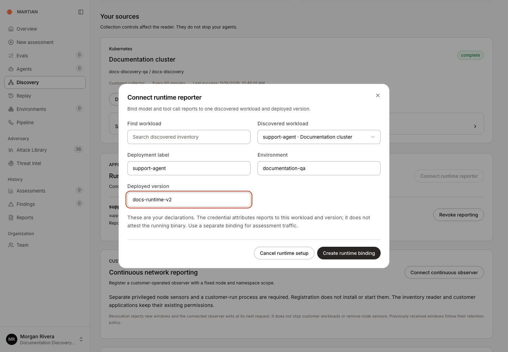
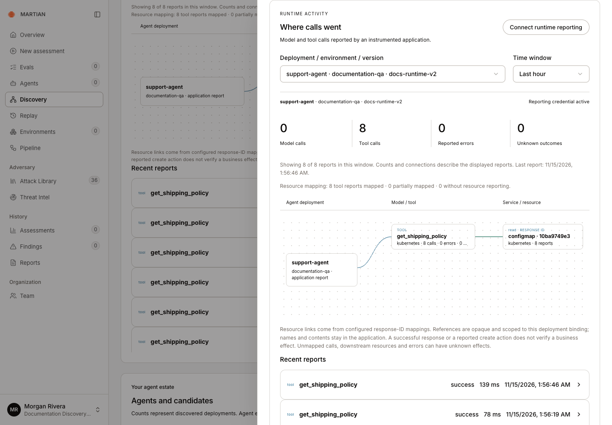
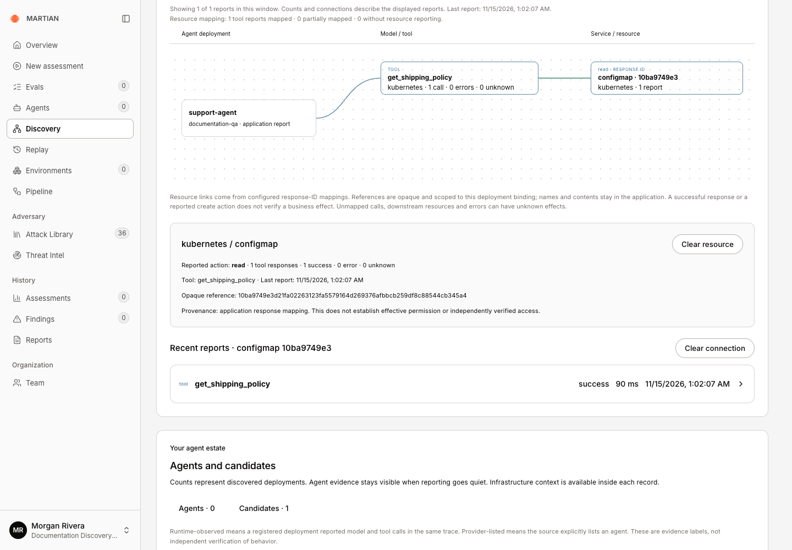
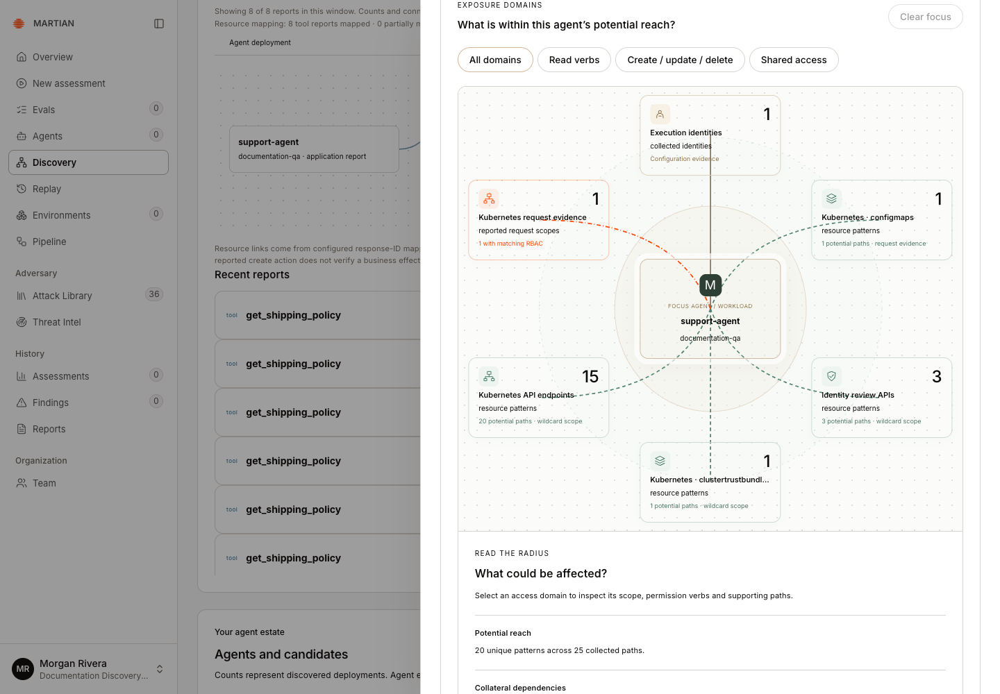
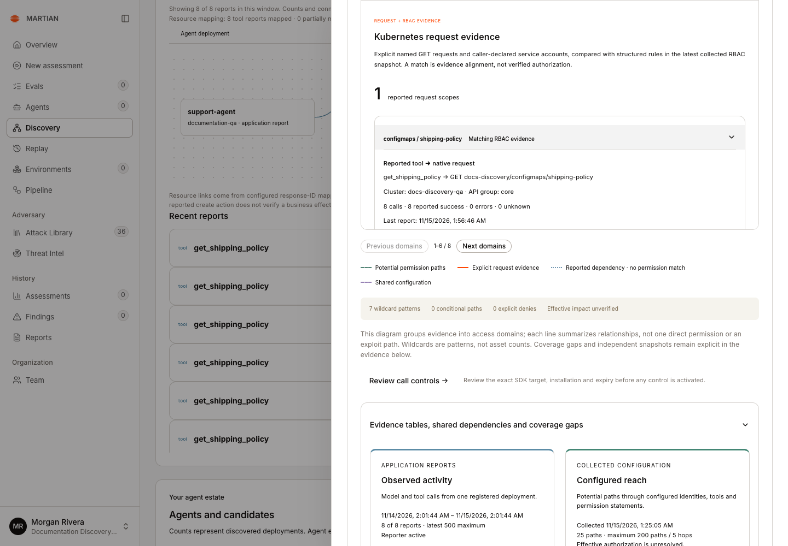

# Inspect runtime activity and blast radius

> Connect a reporter to one workload version, inspect observed calls and compare them with collected access evidence.

Source: [Web version](https://docs.martiansecurity.ai/discovery/runtime-and-blast-radius/)

> **Page qualification:** Current beta console · owner, admin · Verified 2026-11-14 · Isolated Discovery compatibility QA; actual customer Owner with platform_admin false; authorized local Kubernetes provider; unchanged collector and released SDK0.1.3; Backend candidate PR112, unmerged and not deployed to beta. [Verification details](https://raw.githubusercontent.com/MartianSecurity/martian-security-docs/main/public/markdown/reference/verification.md).

Follow application-reported model/tool activity for one deployment and compare it with collected potential access. Success means the intended binding receives real instrumented calls and you can trace each visible relationship to its evidence and time boundary.

## Before you start

An **Owner** or **Admin** enrolls reporting. Any signed-in tenant user can inspect accessible evidence. First [connect an authorized infrastructure source](https://raw.githubusercontent.com/MartianSecurity/martian-security-docs/main/public/markdown/discovery/inventory.md) and collect the workload. Install the compatible Martian SDK in that customer application and explicitly instrument its normal model/tool calls. Do not report invented calls to make a diagram look complete.

Deployment, environment and version labels attribute reports; they do not attest the running binary. Use a separate binding for each intended environment/version and keep assessment traffic distinguishable from other traffic.

## Connect runtime reporting

1.  Open **Discovery → Sources → Runtime reporting**, then **Connect runtime reporter**.
2.  Use **Find workload**, choose **Discovered workload**, then enter **Deployment label**, **Environment** and **Deployed version**. The first 50 search matches are listed; narrow the search if necessary.



Choose the collected workload and explicit deployment, environment and version before creating its private runtime credential.

3.  Click **Create runtime binding**.
4.  Privately save the Binding ID and once-shown **Runtime credential**. Mount the credential as a read-only secret file in that workload and configure its SDK reporter with the trusted Backend HTTPS origin and binding. Click **Credential saved** to clear the credential panel.
5.  Start one reporter per customer application process, create a trace for each invocation and instrument the actual model/tool calls. A successful report is metadata about that call, not an assertion that a downstream business action happened.
6.  Run a bounded legitimate synthetic task through the real application. Check its reporter delivery counters/logs and retained binding after refresh. Missing dashboard events do not establish that no calls occurred: delivery can fail or be dropped.

## Integrate one real call

[Download report\_once.py](https://raw.githubusercontent.com/MartianSecurity/martian-security-docs/main/public/examples/runtime-reporting/report_once.py) for a bounded integration using the SDK’s `martian_redteam.runtime.RuntimeReporter`. Install the [SDK](https://raw.githubusercontent.com/MartianSecurity/martian-security-docs/main/public/markdown/sdk/install-and-configure.md) in the intended enrolled workload, alongside your application’s dependencies. This example is source reviewed and locally checked for imports/setup failure; real Discovery delivery remains unqualified.

Use a trusted module that exposes your existing real model/tool call as a sync or async function. The JSON input file supplies its keyword arguments. Do not put business requests at module import time. Run the helper only in the workload/version that the binding actually describes, using a legitimate authorized synthetic task.

```sh
export MARTIAN_API_URL='https://YOUR-APPROVED-BACKEND-ORIGIN'
export MARTIAN_RUNTIME_BINDING_ID='YOUR-BINDING-UUID'
export MARTIAN_RUNTIME_TOKEN_FILE='/absolute/private/runtime-credential'
.venv/bin/python report_once.py \
  --callback-file ./my_tools.py --callback-function lookup_order \
  --input-file ./private-test-input.json \
  --kind tool --system support --name lookup_order
```

Replace the file/function and trusted kind/system/name with your real integration. For `lookup_order(order_id=...)`, the private input file is a JSON object such as `{"order_id":"YOUR-AUTHORIZED-TEST-ORDER"}`. The runtime credential is distinct from the platform SDK key; the reporter does not load a `.env` file.

The helper starts one reporter, creates one trace and places the **actual callable** inside `trace.call(...)`. It marks success only after the function returns, waits a bounded interval for the reporter’s single delivery attempt, then closes. Its own summary contains trace ID and delivery counters rather than inputs, outputs or secrets; keep any logs written by your application private too. An async application should reuse one reporter per process instead of starting this helper for each production request. Configure timeouts in the real callback/client; the reporter does not cancel a blocked synchronous business request.

| Exit | Interpretation |
| --- | --- |
| 0 | Callable completed and the metadata upload was acknowledged; inspect the corresponding retained event |
| 1 | The callable raised an error; inspect the private application evidence and delivery counters |
| 2 | Setup failed before the observed call |
| 3 | Callable completed, but metadata delivery was not confirmed |

Reporting is separate from business execution. **Do not repeat the callable merely because delivery failed or the dashboard is empty.** `close()` is not a flush/retry: pending or uncertain delivery can be lost and is reflected in `delivery_failed` / `dropped`. Compare the printed trace ID, exact binding, time and call target with retained Runtime activity after refresh; counters alone do not establish business effects.

This minimal integration emits call metadata. Resource links require explicit response-ID mapping through `RuntimeResourceRule` / `trace.resources(...)`; native Kubernetes request matching is a separate opt-in (`native_kubernetes=True` with actual request metadata). Neither is enabled or claimed by this helper. Ask the integrator for mappings supported by your real client contract before relying on those map layers.

## Inspect the runtime map

1.  Open **Discovery → Overview → Runtime activity**, or the record’s Runtime activity view.
2.  Select **Deployment / environment / version** and **Time window**: **Last hour**, **Last 24 hours** or **Last 7 days**.
3.  Read **Where calls went**. Select a model/tool to inspect its configured name, counts, outcomes and recent reports. Use **Previous connections** / **Next connections** when additional targets are available.



The exact binding and Last hour selection survived a real refresh. Eight distinct successful policy reads were retained; two denied calls did not enter the callable.

The captured example is a real read-only `get_shipping_policy` tool in the selected Kubernetes workload. It reads one named synthetic ConfigMap using that workload’s service account. **0 Model calls** and **8 Tool calls** describe eight distinct successful reads from the runtime, gate and network checks. Two blocked attempts did not enter the callable or appear as executed tool reports. A tool-only report can populate this view while the workload remains a candidate; **Runtime-observed** needs model and tool calls in the same trace.

4.  For a resource link, inspect its service/type, opaque reference, reported action, outcome and time. These links require explicit response-ID mappings in the customer integration. Use **Previous resources** / **Next resources** to page the displayed links.



The initial successful lookup mapped the actual response UID to an opaque reference. Later reads in the same binding reuse that reference; this is reported evidence, not a business-impact proof.

5.  Check the bounds: aggregate counts cover a displayed latest-500-event window and individual details the latest 50 events. A selected aggregate can have no corresponding row in that smaller recent-event window. Resource/action links page by 12 for displayed tools.
6.  Refresh, reselect the same binding and time window if needed, and confirm that the actual synthetic call remains in retained evidence.

## Compare configured reach

1.  Switch to **Blast radius** and retain the exact deployment binding. Read the collection receipt/time and freshness of its access evidence.
2.  Inspect runtime-reported domains, collected identity/permission paths and shared configured peers separately. Open the relevant resource or evidence row to see its source and matching limitations.
3.  Use record details such as **Configured access**, **Network evidence**, and **Hosting & identity** to answer their specific evidence questions. A network window or an RBAC policy is not a substitute for an independently verified business effect.



The diagram summarizes the latest collected configuration and reported request evidence. Twenty resource patterns and twenty-five potential paths do not establish effective access or measured business impact.

For the example lookup, **Kubernetes request evidence** links the caller-declared named GET and service account to a matching collected ConfigMap rule. Select the request to inspect its supporting path and collection time. The RBAC snapshot is the latest collected configuration; it is not pinned to the call time or the binding’s declared version. A match establishes evidence alignment, not effective authorization.



The named GET and caller-declared service account align with the latest collected RBAC fields. The independent snapshot does not attest identity or permission at call time.

4.  If a card links an assessment to this deployment, inspect the operator approval, artifact-equivalence declaration and drift status. An operator-attested mapping does not independently prove the deployed binary equals the assessed artifact.
5.  Treat any quantified sandbox loss sample or time-window projection as its labeled conditional scenario. Diagram distance, group size and ring placement are not a risk score or effective-access proof.

## Failure, freshness and limits

If no workload is listed

**No matching workloads** means there is no collected workload matching the search. [Connect an authorized source and collect its inventory](https://raw.githubusercontent.com/MartianSecurity/martian-security-docs/main/public/markdown/discovery/inventory.md), or change the search. Entering a deployment label does not create the missing workload; **Create runtime binding** stays disabled until you select one.


Runtime setup stops until an authorized source has collected a matching workload. Deployment labels alone do not create that inventory record. No binding or credential was created.

-   **No runtime reporters connected** needs enrollment and actual instrumentation, not another inventory refresh.
-   **Revoke reporting** rejects future uploads while retaining history. It does not stop the application, block a call or revoke an independently enrolled call gate.
-   A reporter credential cannot authorize assessments or read console records. Source and gate credentials are separate.
-   Opaque resource references remain within their binding. Unmapped resources, errors and downstream effects can be unknown; do not merge them across deployments by name.
-   Customer-reported success, configured permissions and TCP observations do not independently establish effective access, complete capture or business impact.

Continue with [network observer setup](https://raw.githubusercontent.com/MartianSecurity/martian-security-docs/main/public/markdown/discovery/network-observation.md), [SDK call gates](https://raw.githubusercontent.com/MartianSecurity/martian-security-docs/main/public/markdown/discovery/call-gates.md) or [assessment outcome verification](https://raw.githubusercontent.com/MartianSecurity/martian-security-docs/main/public/markdown/assessments/reproduction-and-limits.md).
