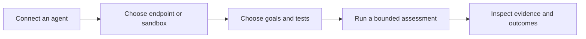

# Martian Security

> Practical customer guides for red teaming, evaluations, and the Martian SDK.

Source: [Web version](https://docs.martiansecurity.ai/)

Find security failures with **red teaming**. Measure response quality with **Evals**. Keep both checks in your development workflow with the **SDK and CI**.

- [Run your first assessment](https://raw.githubusercontent.com/MartianSecurity/martian-security-docs/main/public/markdown/get-started/first-assessment.md): Connect an agent, choose a small test, and inspect the evidence.

- [Run your first evaluation](https://raw.githubusercontent.com/MartianSecurity/martian-security-docs/main/public/markdown/evals/first-run.md): Use a published dataset to compare expected and actual answers.

- [Integrate the SDK and CI](https://raw.githubusercontent.com/MartianSecurity/martian-security-docs/main/public/markdown/sdk/install-and-configure.md): Run local callbacks and record repeatable checks for a tested revision.

## Start with your workspace

Explore the [Local SDK guides](https://raw.githubusercontent.com/MartianSecurity/martian-security-docs/main/public/markdown/local-sdk.md) for evaluations, the local UI, and importing results. The [Community quickstart](https://raw.githubusercontent.com/MartianSecurity/martian-security-docs/main/public/markdown/get-started/quickstart.md) runs without a Martian account or model key. [Editions](https://raw.githubusercontent.com/MartianSecurity/martian-security-docs/main/public/markdown/get-started/editions.md) explains which workflows need a shared workspace.

The SDK guides cover [Martian SDK 0.3.1](https://raw.githubusercontent.com/MartianSecurity/martian-security-docs/main/public/markdown/sdk/install-and-configure.md#sdk-031-at-a-glance), including [pull-request checks with job summaries](https://raw.githubusercontent.com/MartianSecurity/martian-security-docs/main/public/markdown/sdk/ci.md#run-a-local-suite-on-pull-requests) and [portable Evals exports](https://raw.githubusercontent.com/MartianSecurity/martian-security-docs/main/public/markdown/sdk/local-ui.md#export-and-restore-evals-records).

New to Martian? [Accept your invitation and sign in](https://raw.githubusercontent.com/MartianSecurity/martian-security-docs/main/public/markdown/get-started/access.md), then read [the concepts](https://raw.githubusercontent.com/MartianSecurity/martian-security-docs/main/public/markdown/get-started/concepts.md). You need an agent connection that you are authorized to test. Each tutorial explains the role, setup and limits before you start.

## Choose the evidence you need

**Red teaming**

Can an attacker steer this agent outside its intended rules?

A bounded assessment with recorded attempts, findings and verification evidence.

**Evals**

Does this version answer a known set of cases correctly?

Dataset-version-pinned results, scores, comparisons and reviews.

**SDK and CI**

Should this tested revision pass my development checks?

Local test results, retained reports and a recorded gate outcome when configured.

The first assessment moves from an approved connection to evidence you can inspect. A finding’s strength depends on the verification actually recorded.

## Explore the product

Use the [console map](https://raw.githubusercontent.com/MartianSecurity/martian-security-docs/main/public/markdown/reference/console-navigation.md) to find each customer area, including the Evals dashboard, account menu and features that remain templates or previews.

-   [Agents and connections](https://raw.githubusercontent.com/MartianSecurity/martian-security-docs/main/public/markdown/agents/connections.md) — registration, validation and approval.
-   [Attack library](https://raw.githubusercontent.com/MartianSecurity/martian-security-docs/main/public/markdown/library/attacks.md) — individual attack guides, examples and security framework references.
-   [Environments](https://raw.githubusercontent.com/MartianSecurity/martian-security-docs/main/public/markdown/environments/create-and-launch.md) — synthetic seed data and sandbox readiness.
-   [Discovery](https://raw.githubusercontent.com/MartianSecurity/martian-security-docs/main/public/markdown/discovery/inventory.md) — inventory and runtime evidence.
-   [Permissions](https://raw.githubusercontent.com/MartianSecurity/martian-security-docs/main/public/markdown/reference/permissions.md) and [limits](https://raw.githubusercontent.com/MartianSecurity/martian-security-docs/main/public/markdown/reference/limits.md) — understand what your role and environment support.
-   [Troubleshooting](https://raw.githubusercontent.com/MartianSecurity/martian-security-docs/main/public/markdown/reference/troubleshooting.md) — recover without starting duplicate work.
-   [Hermes documentation](https://martiansecurity.github.io/martian-hermes-docs/) — the separate Hermes agent and its operator workflow.
