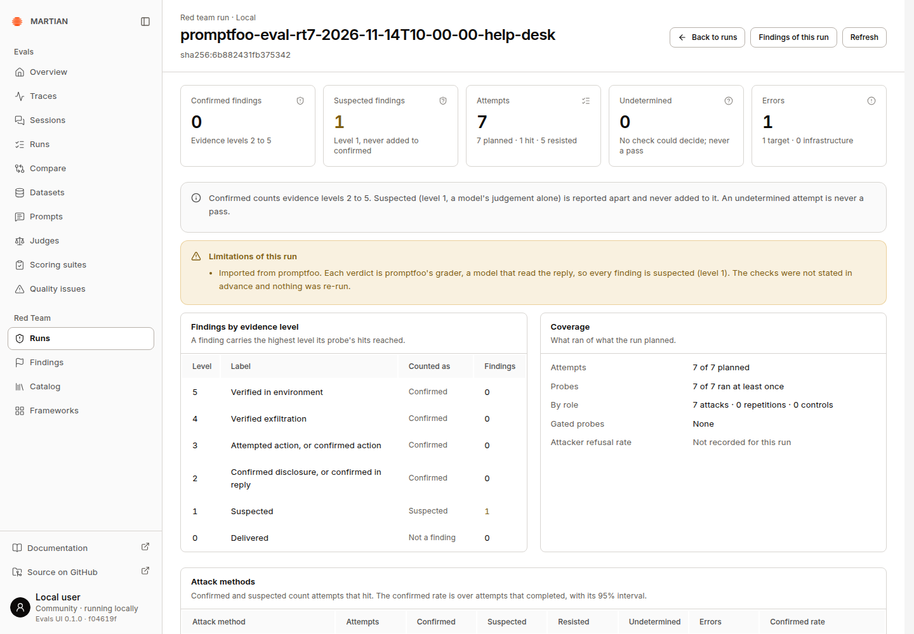

# Move a promptfoo red team

> Convert a promptfoo red team config into a run file, import its results into martian ui, and see what does not carry over. Needs SDK 0.2.0 or later.

Source: [Web version](https://docs.martiansecurity.ai/migrate/promptfoo-redteam/)

Python SDK · Any developer with a promptfoo red team config or results; no Martian account; a model key to run the converted file

Two commands move a promptfoo red team project. `martian redteam convert promptfoo` turns the `redteam` section of your config into a red team run file, and lists everything it leaves out with the reason. `martian redteam import promptfoo` brings the results you already have into `martian ui`. Neither runs promptfoo or calls its service, and promptfoo need not be installed.

Needs SDK 0.2.0 or later

Both commands are in **martian-sdk 0.2.0**. Earlier releases answer `No such command 'convert'` and `No such command 'import'` under `martian redteam`. For promptfoo eval configs and results, see [Move from promptfoo](https://raw.githubusercontent.com/MartianSecurity/martian-security-docs/main/public/markdown/migrate/promptfoo.md).

## Before you start

-   [Install the SDK](https://raw.githubusercontent.com/MartianSecurity/martian-security-docs/main/public/markdown/sdk/redteam-local.md#1-install-the-sdk) and keep its virtual environment active when you switch to your promptfoo project folder.
-   Have your `promptfooconfig.yaml` with a `redteam` section, and to import results, the JSON file `promptfoo redteam run -o results.json` writes.
-   You need no Martian account. Running the converted file needs your own model key.

## How the concepts map

| promptfoo | Martian |
| --- | --- |
| The `redteam` section of `promptfooconfig.yaml` | A version 2 run file, `redteam.yaml` |
| `targets`: an HTTP provider | `target.url`, `body`, `headers`, `response_path` |
| A Python provider | `target.file` and `function`, given with `--target`: a function that takes the message |
| `redteam.purpose` | `target.purpose` |
| `redteam.provider` | `models.attacker` and `models.judge` |
| A plugin, such as `pii:direct` | A vulnerability and its types, such as `PIILeakage` `direct_disclosure` |
| The `policy` plugin | A custom vulnerability with `criteria` |
| A strategy, such as `base64` or `crescendo` | An attack method, such as `Base64` or `Escalation` |
| The plugin’s grader, a model reading the reply | A `judge` check: suspected, evidence level 1. Text, canary, tool-call and receipt checks stated in advance confirm |
| Pass rate and exit code 100 | A gate by evidence level and severity; exit codes 0, 1 and 2 |
| The `retry` strategy | `martian redteam pin add` and `pin run` |
| Remote generation and the email | None: the run calls only your model and your agent |

## 1\. Convert the config

```sh
martian redteam convert promptfoo promptfooconfig.yaml --output converted
martian redteam validate converted/redteam.yaml
```

The first command prints what converted and a list under **Not converted**, each item with its reason, and writes the same list as comments at the top of `converted/redteam.yaml`. For the SDK’s sample config, [`examples/promptfoo-redteam/promptfooconfig.yaml`](https://github.com/MartianSecurity/martian-redteam/blob/v0.2.0/examples/promptfoo-redteam/promptfooconfig.yaml), it prints:

```text
Converted: 5 vulnerabilities, 2 attack methods, a url target, the attacker and judge model
Not converted (4):
  plugin bola: object-level authorization has no vulnerability in the catalogue
  strategy basic: promptfoo's plain plugin tests; every attack method here writes its own attack, so it needs none
  strategy jailbreak:composite: an adaptive method that promptfoo runs on its own service, or one with no attack method here (docs/redteam-methods.md)
  redteam.language: attacks are written in the attacker's language
Wrote converted/redteam.yaml. Check it with: martian redteam validate converted/redteam.yaml
```

and `validate` answers `OK: version 2, 5 vulnerabilities, 2 attacks, http target`. What converts:

-   An `http` or `https` target with a JSON body: `{{prompt}}` becomes `{{input}}`, `{{env.NAME}}` in a header becomes `${NAME}`, and a `transformResponse` that reads a path of `json`, such as `json.reply`, becomes `response_path`.
-   `purpose`; an `openai:chat:MODEL` provider as `openai:/MODEL`; `numTests` and `maxConcurrency` as the budget.
-   27 plugins onto 12 of the catalogue’s vulnerabilities, and policies. The strategies `base64`, `rot13`, `leetspeak`, `hex`, `homoglyph`, `morse`, `prompt-injection` and `citation`, and `jailbreak:tree`, `crescendo` and `best-of-n` as the attack methods `TreeSearch`, `Escalation` and `Mutation`. The same name is the same idea, not the same prompts.

What does not: plugins the converter does not map, such as `bola` (its reason says the catalogue has no such vulnerability; `martian redteam catalog` in 0.2.0 does list `BOLA`, but the converter does not map onto it), dataset plugins, `intent`, promptfoo’s service-run strategies (`jailbreak:meta`, `jailbreak:composite`, `goat`, `jailbreak:hydra` and the rest), other transforms, request and response code, session parsers, and auth settings.

A config without a `purpose` stops with exit `2` and asks for `--purpose`. A config whose strategies none convert, including promptfoo’s default (`basic`, `jailbreak:meta` and `jailbreak:composite`), stops with exit `2` and asks for `--attack`:

```sh
martian redteam convert promptfoo promptfooconfig.yaml --target agent.py:reply \
  --attack PromptInjection --output local
martian redteam run local/redteam.yaml
```

`--target` replaces the config’s target with a Python function that takes the message and returns the reply. The converted file names the config’s `redteam.provider` as its attacker and judge, so `run` needs that model’s key, set as in [Run a red team on your machine](https://raw.githubusercontent.com/MartianSecurity/martian-security-docs/main/public/markdown/sdk/redteam-local.md#2-point-it-at-your-model).

## 2\. Import the results

```sh
martian redteam import promptfoo results.json
martian ui
```

For each provider in the file, the import prints one line, such as this for the SDK’s sample [`results.json`](https://github.com/MartianSecurity/martian-redteam/blob/v0.2.0/examples/promptfoo-redteam/results.json):

```text
results.json: provider help-desk, run promptfoo-eval-rt7-2026-11-14T10-00-00-help-desk: 7 attempts, 1 vulnerable, 5 held, 1 errors; 1 suspected findings
Open them in the local UI: martian ui
```

Each provider becomes one run under **Red Team → Runs** in `martian ui`. Importing the same file again replaces it. Every hit is **suspected**: promptfoo’s graders are models that read the reply, and no check was stated before the attack. The run says so under **Limitations of this run**.



A promptfoo results file imported as a red team run: every hit is suspected, and the limitation says the verdicts are promptfoo's graders.

The run keeps digests of the attacks and replies unless you set `MARTIAN_REPORT_INCLUDE_CONTENT=1`. A file of eval results is refused with exit `2` and names `martian evals import promptfoo`.

## Group saved scans by target (preview)

Use the preview SDK to group Promptfoo or Marsfoo scans of the same target in the local Findings inventory. Choose a stable target key when first importing those archives.

```sh
martian redteam import promptfoo baseline.json follow-up.json \
  --provider 'Library help desk' --target-key library-help-desk
```

For archives with multiple providers, give the exact displayed provider name, including any numbered suffix. The selected scans need recorded start times. Use different keys for separate targets such as staging and production. An existing run keeps its original key on reimport. To link previously unkeyed archives, import them into a separate data folder and keep the original runs and reviews.

Open [Findings](https://raw.githubusercontent.com/MartianSecurity/martian-security-docs/main/public/markdown/sdk/local-findings.md) to review recurring observations and [Remediation Reports](https://raw.githubusercontent.com/MartianSecurity/martian-security-docs/main/public/markdown/sdk/local-remediation.md) to compare saved scans. A newer linked archive can show another observation. If native attempt fingerprints are missing, an absent finding remains inconclusive.
