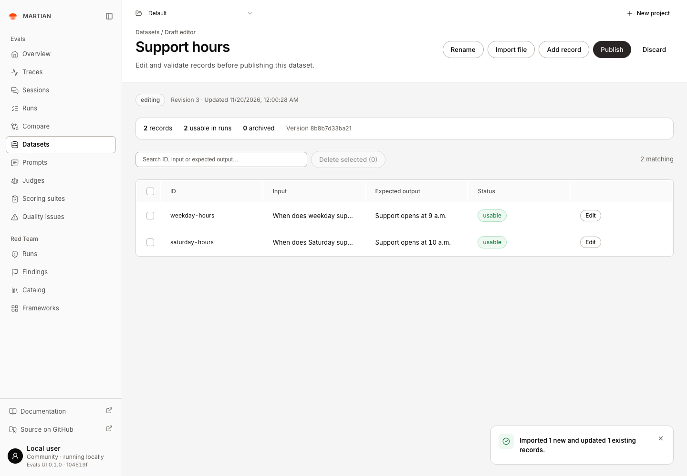
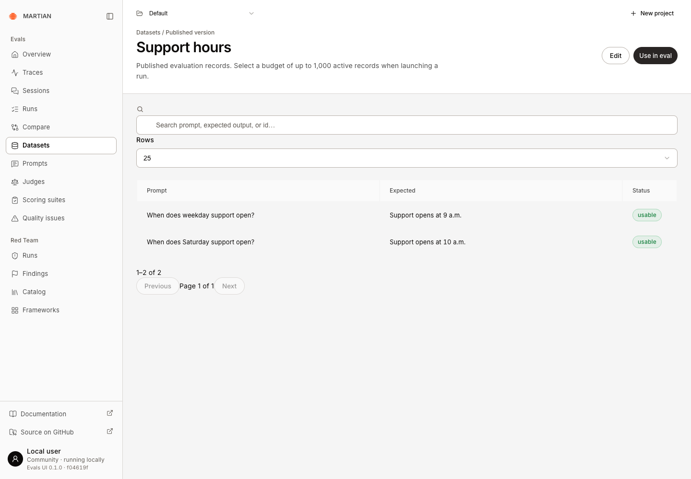

# Create and import Evals datasets

> Write JSON Lines or CSV cases for a local suite, import records in the local UI, or bring in recorded runs from another tool.

Source: [Web version](https://docs.martiansecurity.ai/sdk/local-datasets/)

Python SDK · Local user

Use a case file for `martian evals run` or a published dataset for runs you start in the local UI. Both work on your machine with the [Local SDK installed](https://raw.githubusercontent.com/MartianSecurity/martian-security-docs/main/public/markdown/sdk/local-installation.md).

| Goal | Format or action |
| --- | --- |
| Run a YAML suite | Point `data` at a JSON Lines or CSV case file |
| Run from the local UI | Create a draft, add or import records, then publish a dataset version |
| View results from another tool | [Import existing runs](https://raw.githubusercontent.com/MartianSecurity/martian-security-docs/main/public/markdown/sdk/local-datasets.md#3-import-existing-runs) |

## 1\. Write case files for a YAML suite

Each case needs an input and can include expectations used by the suite’s checks. Give cases stable, unique IDs so Compare can pair the same cases across runs.

Save this as `cases.jsonl`. Write one JSON object per line.

```json
{"id":"weekday-hours","input":"When does weekday support open?","expectations":{"opening":"9 a.m."}}
{"id":"saturday-hours","input":"When does Saturday support open?","expectations":{"opening":"10 a.m."}}
```

For a Python function with several arguments, use `inputs` as an object whose keys are argument names. A plain `input` becomes the `message` argument by default.

For CSV, use a header row. The runner treats columns other than `id`, `input`, and `output` as named expectations. Here the `opening` column supplies the same expectation as the JSON Lines example.

```csv
id,input,opening
weekday-hours,When does weekday support open?,9 a.m.
saturday-hours,When does Saturday support open?,10 a.m.
```

Set `data: cases.jsonl` or `data: cases.csv` in your suite. Use `expectation: opening` in a compatible check, such as `contains`. The [YAML reference](https://raw.githubusercontent.com/MartianSecurity/martian-security-docs/main/public/markdown/sdk/local-evals-yaml.md) shows how the suite connects them.

To grade replies you already have, include `output` for each case. The [saved-reply example](https://raw.githubusercontent.com/MartianSecurity/martian-security-docs/main/public/markdown/sdk/local-evals-yaml.md#grade-saved-replies) reads those replies from disk.

## 2\. Create a dataset in the local UI

1.  Start [the local UI](https://raw.githubusercontent.com/MartianSecurity/martian-security-docs/main/public/markdown/sdk/local-ui.md#1-install-and-start-the-ui), open **Datasets**, and select **New dataset**.
2.  Enter a name such as `Support hours` and select **Create draft**.
3.  Choose **Add record** to enter a case by hand. Enter **Record ID**, **Input**, and **Expected output**, then select **Add record**. To load several cases, use **Import file**.

### Import a case file

The UI imports JSON, JSON Lines, and CSV files up to 20 MiB. Use `expected_output` for the reference answer. In CSV, use the columns `id`, `input`, `expected_output`, and `status`. Imports update records with matching IDs and add the other records.

Save the following as `support-hours.jsonl`. Select **Import file**, choose the file in **Import records**, and select **Import**.

```json
{"id":"weekday-hours","input":"When does weekday support open?","expected_output":"Support opens at 9 a.m.","status":"ACTIVE"}
{"id":"saturday-hours","input":"When does Saturday support open?","expected_output":"Support opens at 10 a.m.","status":"ACTIVE"}
```

To convert the suite examples above, give each record an `expected_output` containing the full reference reply. Keep its ID and input. The UI’s exact-match check compares with that full reply. The suite’s `contains` check compares with the phrase under `expectations.opening`.

After the import finishes, confirm you have two usable records. Open a row’s **Edit** action if you need to correct an input or expected reply.



The draft lists both imported answers and shows which cases are usable.

### Publish and select the dataset

1.  Select **Publish**, enter a rationale of at least eight characters, and confirm.
2.  In **Published datasets**, open **Support hours** and check that both records are usable.
3.  Select **Use in eval** to open the run form with this dataset. Follow [Run an eval from the local UI](https://raw.githubusercontent.com/MartianSecurity/martian-security-docs/main/public/markdown/sdk/local-ui.md#4-run-an-eval-from-the-ui) to select a target and read the results.



Open the published dataset and select Use in eval to start with these cases.

If **Publish** is disabled, check that the draft contains usable active records. For **duplicate case IDs** from the suite runner, give each case a unique ID. If a check reports a missing expectation, match the suite’s `expectation` to a key in every relevant case.

## 3\. Import existing runs

| Source | Guide |
| --- | --- |
| Martian portable export | [Restore an Evals store](https://raw.githubusercontent.com/MartianSecurity/martian-security-docs/main/public/markdown/sdk/local-ui.md#export-and-restore-evals-records) |
| MLflow tracking store | [Import from MLflow](https://raw.githubusercontent.com/MartianSecurity/martian-security-docs/main/public/markdown/migrate/mlflow.md) |
| promptfoo result files | [Import promptfoo results](https://raw.githubusercontent.com/MartianSecurity/martian-security-docs/main/public/markdown/migrate/promptfoo.md#2-import-your-results) |
| Inspect AI logs | [Import Inspect AI logs](https://raw.githubusercontent.com/MartianSecurity/martian-security-docs/main/public/markdown/migrate/inspect.md) |

For a team dataset managed in the hosted console, see [Create and publish workspace datasets](https://raw.githubusercontent.com/MartianSecurity/martian-security-docs/main/public/markdown/evals/datasets.md).
