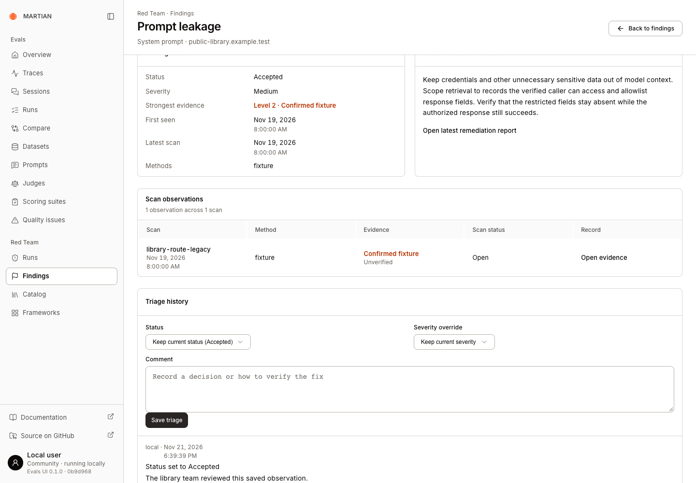

# Review and triage local findings

> Review findings across saved Red Team scans, save triage decisions, and export evidence for another reviewer or CI.

Source: [Web version](https://docs.martiansecurity.ai/sdk/local-findings/)

Python SDK · Developer or reviewer using the single-user local workbench

SDK version

The project-wide Findings view requires SDK 0.4.0 or later and its [bundled workbench](https://raw.githubusercontent.com/MartianSecurity/martian-security-docs/main/public/markdown/local-sdk.md#open-the-bundled-workbench).

Use Findings to review the security observations recorded in one local project. A developer or reviewer can use saved scans without a Martian account or model key.

## Before you start

-   Have a finished Red Team scan. For a first look, [import the sample scan](https://raw.githubusercontent.com/MartianSecurity/martian-security-docs/main/public/markdown/migrate/promptfoo-redteam.md#2-import-the-results). The Community quickstart creates Evals runs. Findings fills from saved Red Team scans.
-   Start the [bundled workbench](https://raw.githubusercontent.com/MartianSecurity/martian-security-docs/main/public/markdown/local-sdk.md#open-the-bundled-workbench) with the folder that holds the scan. If Findings is empty, check **Red Team → Runs** in the same project before changing the filters.

## 1\. Find the evidence

1.  Select the local project, then open **Red Team → Findings**. Search by finding, target or method. Filter by severity, status, category, vulnerability type, evidence, target or recurrence.
2.  To start with one scan, open its run report and select **Findings of this run**. **Clear filters** keeps that scan selected. **Show all scans** restores the project-wide view. The totals above the table always describe the project.
3.  Open a finding by name. Use its observations to see when it occurred, the method and evidence level, and the saved scan or attempt. Re-judging a scan reviews its previous observations and adds no new observation to the inventory.

The inventory groups observations by recorded target identity, vulnerability, finding type and objective. Legacy network scans with no recorded route, network targets using custom headers, query parameters or inline credentials, and stdio MCP targets stay scoped to their own runs. Assign an explicit target key when grouping imports for a known target.

## 2\. Save a triage decision

1.  Choose a status such as **Open**, **Accepted**, **Fixed**, **False positive** or **Ignored**. Add a comment and, if needed, override the severity. **Restore scan severity** returns to the highest severity recorded for the finding.
2.  Select **Save triage**. The decision appears in the history and the original scan evidence, severity and results remain available. Refresh to read the saved entry.
3.  If the browser loses the response to a save, select **Retry saved triage**. It resends the same decision and reuses the original history entry if the first request saved it.



An accepted review retained in the published SDK workbench after refreshing the finding.

**Seen after fix** marks a later observation. The cutoff is the review time for a manual fix and the follow-up scan’s start time for a [verified fix](https://raw.githubusercontent.com/MartianSecurity/martian-security-docs/main/public/markdown/sdk/local-remediation.md#3-verify-a-fix-against-a-saved-follow-up). The inventory uses scan timestamps, including for scans imported after the review.

## 3\. Export the findings or move reviews

**Export CSV** and **Export SARIF** include all findings that match the current filters, across pages. Exports include finding summaries, evidence labels and guidance. Conversations and reviewer comments stay in the local store. SARIF uses stable finding fingerprints.

**Export Colang** builds a NeMo Guardrails archive for the current filters. Choose **Colang 1.0** or **Colang 2.x**. Confirmed findings with supported message policies can produce rules. The manifest also identifies findings that need confirmation or application controls and marks dismissed findings. Review the rules before integrating them into your application.

The CLI reads the same project inventory. Set `--project-id` when using a project other than `default`. List with `--format json` to get the full ID for `FINDING_ID`.

```sh
martian redteam findings list --status open --evidence confirmed --format json --data-dir ./evals-data
martian redteam findings show FINDING_ID --data-dir ./evals-data
martian redteam findings list --status open --format sarif -o findings.sarif --data-dir ./evals-data
```

To move triage history, first restore the matching scans into the same project at the destination. Use a copy of the backed-up local data folder, [push the saved native scan files](https://github.com/MartianSecurity/martian-redteam/blob/a48b354679954a4cefab076fe1ba1c6cc0bb0120/docs/redteam-api.md#pushed-runs) to the destination’s local server, or [reimport the original Promptfoo or Marsfoo archives with the same target key](https://raw.githubusercontent.com/MartianSecurity/martian-security-docs/main/public/markdown/migrate/promptfoo-redteam.md#group-saved-scans-by-target). A verified fix needs both scans. Preview the import, then apply it.

```sh
martian redteam findings export-triage --data-dir ./evals-data -o reviews.json
martian redteam findings import-triage reviews.json --data-dir ./restored-evals --dry-run
martian redteam findings import-triage reviews.json --data-dir ./restored-evals
```

The import keeps review IDs, timestamps, authors and evidence references. It reuses reviews with matching IDs and content. If a review ID conflicts or required scan evidence is missing, correct the destination and rerun the dry run. Keep the archive private because it contains review comments.

Continue to [Remediation Reports](https://raw.githubusercontent.com/MartianSecurity/martian-security-docs/main/public/markdown/sdk/local-remediation.md) or [read local findings through MCP](https://raw.githubusercontent.com/MartianSecurity/martian-security-docs/main/public/markdown/sdk/local-mcp.md).
